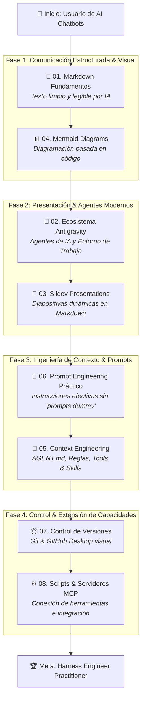

# 📦 Curso de Harness Engineering para Perfiles No Técnicos

Bienvenido al kit de distribución del curso de **Harness Engineering** diseñado para profesionales administrativos, docentes, contadores, ejecutivos y líderes de negocio.

Este programa te llevará gradualmente desde el uso básico de chatbots de Inteligencia Artificial hasta la capacidad de estructurar **entornos de contexto (Harness)**, automatizaciones sencillas y conexión de servidores **MCP (Model Context Protocol)**, sin requerir conocimientos previos de programación ni uso de terminales.


## NOTA!

este curso no esta pensado para ser leido solo, un asesor/mentor es requerido.

---

## 📁 Estructura del Kit de Distribución

Este curso se distribuye como una carpeta autónoma que contiene los siguientes tres elementos fundamentales:

```text
curso-_harness_engineering/
├── 🌐 index.html                   # Plataforma Web Interactiva (Wizard + Evaluación)
├── 📂 assets/                      # Estilos, lógica y banco de preguntas
│   ├── css/styles.css
│   └── js/ (modulesData.js, quizData.js, app.js)
├── 📄 README.md                   # (Este archivo) Guía general del curso y Roadmap
├── 📂 presentation.ppt               # Presentación principal (PPT)
└── 📂 docs/                       # Guías conceptuales y módulos de estudio profundo
    ├── 01_markdown_guide.md
    ├── 02_antigravity_guide.md
    ├── 03_slidev_guide.md
    ├── 04_mermaid_guide.md
    ├── 05_context_engineering.md
    ├── 06_prompt_engineering.md
    ├── 07_version_control.md
    └── 08_mcp_and_scripts.md
```

### 🌐 Cómo Abrir la Plataforma Web Interactiva:
- Solo abre [index.html](file:///home/gallem/Desktop/curso-_harness_engineering/index.html) directamente en tu navegador preferido (Chrome, Edge, Firefox, Safari).
- Incluye navegación tipo Wizard paso a paso, progreso dinámico, renderizado en vivo de diagramas Mermaid y Evaluación Final con persistencia en `LocalStorage` y generación de certificado.

---

## 🗺️ Mapa de Aprendizaje (Roadmap del Curso)



---

## 📚 Componentes del Curso

### 1. 🛝 Presentación de Diapositivas (PPT)


ppt en esta carpeta

---

### 2. 📖 Módulos y Guías Conceptuales de Apoyo
Ubicados en la carpeta [`docs/`](file:///home/gallem/Desktop/curso-_harness_engineering/docs):

| Módulo | Tema Principal | Guía de Detalle |
| :--- | :--- | :--- |
| **01** | **Markdown** | [Guía 01: Markdown Fundamentos](file:///home/gallem/Desktop/curso-_harness_engineering/docs/01_markdown_guide.md) |
| **02** | **Ecosistema de Agentes** | [Guía 02: Antigravity, OpenCode, Claude, Pi y DeepSeek](file:///home/gallem/Desktop/curso-_harness_engineering/docs/02_antigravity_guide.md) |
| **03** | **Slidev** | [Guía 03: Presentaciones con Slidev](file:///home/gallem/Desktop/curso-_harness_engineering/docs/03_slidev_guide.md) |
| **04** | **Mermaid** | [Guía 04: Diagramas con Mermaid](file:///home/gallem/Desktop/curso-_harness_engineering/docs/04_mermaid_guide.md) |
| **05** | **Context Engineering** | [Guía 05: Ingeniería de Contexto](file:///home/gallem/Desktop/curso-_harness_engineering/docs/05_context_engineering.md) |
| **06** | **Prompt Engineering** | [Guía 06: Prompt Engineering Práctico](file:///home/gallem/Desktop/curso-_harness_engineering/docs/06_prompt_engineering.md) |
| **07** | **Control de Versiones** | [Guía 07: Git y GitHub Desktop](file:///home/gallem/Desktop/curso-_harness_engineering/docs/07_version_control.md) |
| **08** | **MCP y Automatización** | [Guía 08: MCP y Scripts Asistidos](file:///home/gallem/Desktop/curso-_harness_engineering/docs/08_mcp_and_scripts.md) |

---

## 🛠️ Entorno de Trabajo: Editores de Código y Texto Recomendados

Aunque este curso **no requiere programar**, un practicante de Harness Engineering interactúa con archivos de texto plano (`.md`, `AGENT.md`, diagramas Mermaid). No usamos Microsoft Word porque incluye formatos invisibles; en su lugar, se recomienda instalar un **editor de código moderno**:

- **Visual Studio Code (VS Code)**: El estándar mundial gratuito de Microsoft (Windows/Mac/Linux), con soporte excelente para previsualizar Markdown y Mermaid.
- **Zed**: Editor de última generación ultra-ligero y rápido, desarrollado en Rust, con integración nativa para modelos de IA.
- **Cursor / Windsurf**: Editores basados en VS Code con agentes de IA autónomos integrados en el espacio de trabajo.
- **Obsidian**: Excelente para organizar notas y procedimientos interconectados en Markdown local.

---

## 💡 Prerrequisitos Esperados vs No Requeridos

### ✅ Lo que SÍ necesitas:
- Dominio en el uso diario de la computadora e Internet.
- Experiencia previa usando chatbots de Inteligencia Artificial (ChatGPT, Claude, Gemini, etc.).
- Capacidad de análisis crítico y lectura analítica.

### ❌ Lo que NO necesitas:
- Saber programar o escribir código previo.
- Experiencia en uso de terminal o comandos Unix/Linux.
- Conocimiento previo de Git, Markdown o diagramación técnica.
