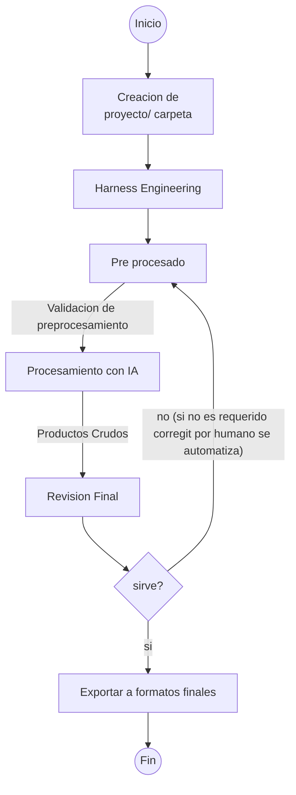

## Proceso para crear este proyecto 





### Version extendida
graph TD
    A((Inicio)) --> X1
    
    subgraph SG_X[" "]
        X1[Creacion de\n proyecto/ carpeta]
        X2[Detalles:\n- Estructura de carpetas\n- Nomenclatura\n- Metadata inicial]
    end
    
    X1 --> B1
    
    subgraph SG_B[" "]
        B1[Harness Engineering]
        B2[Detalles:\n- Diseño inicial\n- Especificaciones\n- Requerimientos técnicos]
    end
    
    B1 --> C1
    
    subgraph SG_C[" "]
        C1[Pre procesado]
        C2[Detalles:\n- Limpieza de datos\n- Normalización\n- Preparación de inputs]
    end
    
    C1 -- Validacion de preprocesamiento --> D1
    
    subgraph SG_D[" "]
        D1[Procesamiento con IA]
        D2[Detalles:\n- Algoritmos aplicados\n- Modelos utilizados\n- Parámetros de configuración]
    end
    
    D1 -- Productos Crudos --> E1
    
    subgraph SG_E[" "]
        E1[Revision Final]
        E2[Detalles:\n- Control de calidad\n- Verificación de outputs\n- Validación de resultados]
    end
    
    E1 --> F{sirve?}

    F -- no (si no es requerido corregir por humano se automatiza) --> C1
    F -- si --> G1
    
    subgraph SG_G[" "]
        G1[Exportar a formatos finales]
        G2[Detalles:\n- Formatos de salida\n- Documentación\n- Entregables]
    end

    G1 --> H((Fin))
```mermaid
```
