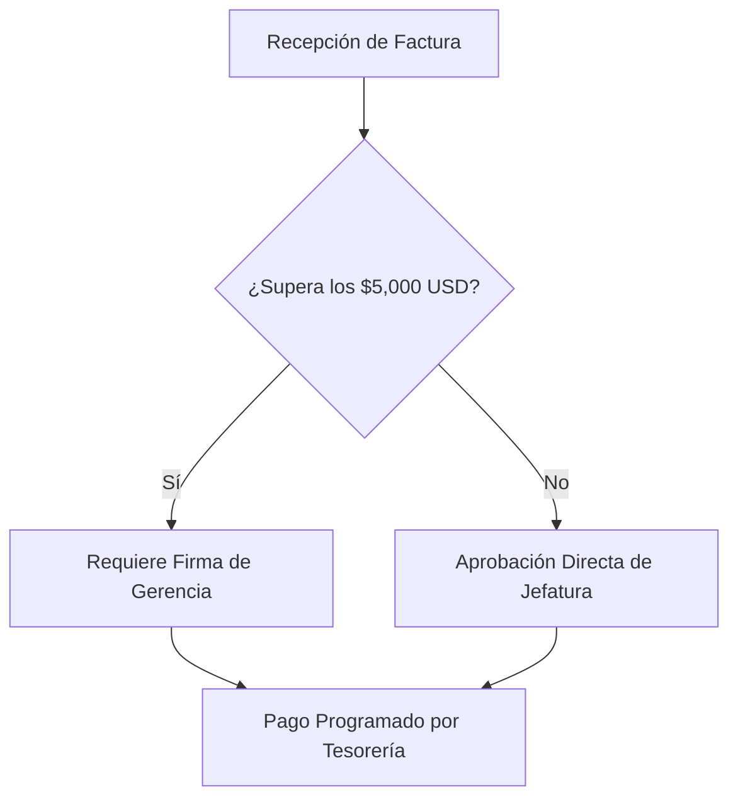

# Módulo 04: Mermaid - Diagramas como Código para Procesos Administrativos

## 🎯 Objetivo del Módulo
Aprender la herramienta **Mermaid**, entender el paradigma de "Diagramas como Código" (*Diagrams as Code*) y ser capaz de solicitar y auditar diagramas de flujo, organigramas y mapas de proceso generados por IA.

---

## 📊 ¿Qué es Mermaid?

Tradicomalmente, para hacer un flujograma o diagrama de procesos se utilizan programas como Microsoft Visio, Lucidchart o Canva, donde se arrastran figuras y líneas manualmente.

**Mermaid** permite crear diagramas renderizados mediante texto dentro de archivos Markdown.

### Beneficios para el Profesional No Técnico:
- **Entendido por la IA**: La IA puede entender tu proceso de negocio y dibujarlo automáticamente en sintaxis Mermaid.
- **Eficiencia Extrema de Tokens**: Un diagrama completo escrito en Mermaid consume entre **20 y 50 tokens** de contexto. En comparación, analizar una imagen o un archivo Visio (.vsdx) consume miles de tokens y requiere modelos de visión más costosos y lentos (ahorro superior al **90%** en uso de ventana de contexto).
- **Fácil Edición**: Modificar un paso del proceso requiere cambiar una sola línea de texto, no rediseñar todo el dibujo.
- **Renderizado Nativo**: Plataformas como GitHub, Notion, Slidev y Antigravity muestran los diagramas Mermaid automáticamente.

---

## 📐 Ejemplos Prácticos de Sintaxis Mermaid

### 1. Diagrama de Flujo de Aprobar una Factura (`flowchart TD`)



### Código Mermaid Detrás del Diagrama:

```text
flowchart TD
    A[Recepción de Factura] --> B{¿Supera los $5,000 USD?}
    B -- Sí --> C[Requiere Firma de Gerencia]
    B -- No --> D[Aprobación Directa de Jefatura]
    C --> E[Pago Programado por Tesorería]
    D --> E[Pago Programado por Tesorería]
```

---

## 🎨 Exportación y Formatos de Salida

Los diagramas Mermaid se pueden convertir en:
- **PNG / JPEG**: Para insertar en documentos de Word, correos o presentaciones de PowerPoint tradicionales.
- **SVG (Vectorial)**: Ideal para impresiones de alta resolución o gigantografías de procesos.
- **PDF**: Para anexos técnicos de manuales de procedimientos y políticas internas.

---

## 📝 Tarea Práctica del Módulo (Homework 04)

**Objetivo:** Diseñar un diagrama de flujo de un proceso operativo real de tu organización utilizando Mermaid.

### Instrucciones Paso a Paso:
1. Elige un proceso habitual de tu oficina (por ejemplo: *Aprobación de Vacaciones*, *Solicitud de Viáticos*, *Compra de Insumos* o *Alta de Cliente*).
2. Crea un archivo llamado `diagrama_proceso_negocio.md`.
3. Escribe un bloque Mermaid de tipo `flowchart TD` que contenga:
   - Un nodo de inicio rectangular (`[Inicio]`).
   - Al menos un **rombo de decisión con llaves** (`{¿Pregunta o condición?}`).
   - Dos caminos diferenciados: `Sí` y `No`.
   - Dos nodos de fin o acciones derivadas.
4. Prueba tu código en [mermaid.live](https://mermaid.live/) o en la vista previa de VS Code para verificar que dibuja correctamente.
5. **Entregable:** Archivo `diagrama_proceso_negocio.md` con el bloque de código Mermaid funcional.

---

## 🔗 Referencias Externas y Recursos
- [Documentación Oficial de Mermaid.js](https://mermaid.js.org/)
- [Editor en Vivo Mermaid Live Editor](https://mermaid.live/)
