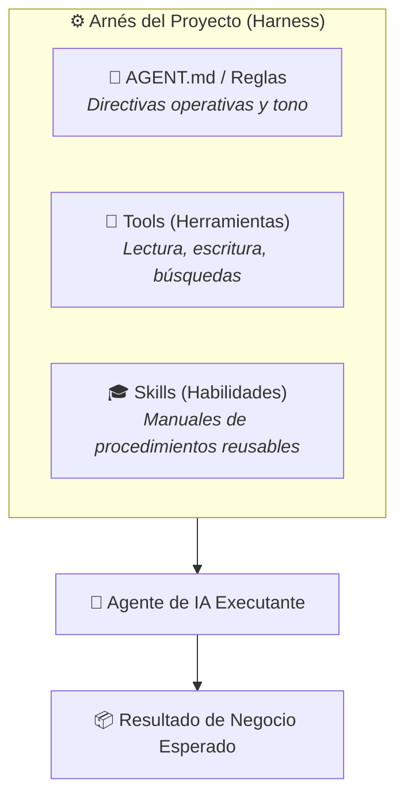

# Módulo 05: Context Engineering - El Corazón del Harness Engineering

## 🎯 Objetivo del Módulo
Dominar los principios de la **Ingeniería de Contexto** (*Context Engineering*), comprender por qué el contexto supera a la "memoria" del modelo y aprender a construir archivos de arnés (`AGENT.md`, reglas, *tools* y *skills*).

---

## 🧠 Contexto vs Memoria: El Gran Mito de la Inteligencia Artificial

Un error común entre los usuarios no técnicos es pensar que la IA "recuerda" conversaciones pasadas como un ser humano.

### La Realidad Técnica:
- Los modelos de IA son **estáticos**. En cada interacción, leen todo el texto contenido en la ventana de contexto actual.
- Si el contexto es desordenado, ambiguo o contradictorio, la IA cometerá errores ("alucinaciones").
- La **Ingeniería de Contexto** consiste en diseñar la arquitectura de información exacta que el agente necesita leer para ejecutar su trabajo con 100% de precisión.

---

## 📄 Componentes del Arnés de IA (Harness Architecture)



---

## 📋 Estructura de un Archivo `AGENT.md` (Ejemplo Administrativo)

El archivo `AGENT.md` se coloca en la raíz del proyecto para que la IA entienda el marco de trabajo automáticamente:

```markdown
# Directivas del Agente Administrativo

## Rol y Objetivo
Eres el Asistente Ejecutivo de la Dirección de Finanzas. Tu objetivo es revisar reportes de gastos y preparar borradores de presupuestos.

## Reglas Inquebrantables
1. **Moneda Estándar**: Todos los valores deben expresarse en USD.
2. **Tono de Comunicación**: Estrictamente formal y corporativo.
3. **Verificación de Datos**: Nunca asumas un gasto no justificado; solicita aclaración si falta el recibo correspondiente.

## Formato de Salida
Todas las respuestas deben entregarse en formato Markdown estructurado con tablas resumidas.
```

---

## 🧰 Tools & Skills: Marcando la Diferencia

- **Tools (Herramientas)**: Son los "brazos y piernas" del agente. Le permiten leer un archivo Excel, consultar una base de datos o generar un PDF.
- **Skills (Habilidades)**: Son paquetes de instrucciones paso a paso para resolver un problema específico (ej. "Skill para Auditoría de Gastos de Viaje").

---

## 🔗 Referencias Externas y Recursos
- [Artículo: Context Engineering for AI Agents (Anthropic)](https://www.anthropic.com/research)
- [Guía de Configuración de AGENT.md y System Prompts](https://antigravity.google)
