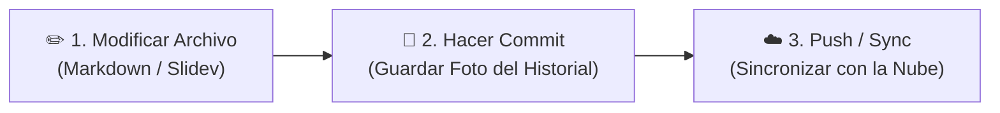

# Módulo 07: Control de Versiones con Git y GitHub Desktop

## 🎯 Objetivo del Módulo
Comprender por qué el **Control de Versiones** es esencial en el Harness Engineering, perder el miedo a Git y dominar el flujo de trabajo mediante la interfaz gráfica de **GitHub Desktop** sin tocar la terminal.

---

## 📦 ¿Por qué un Administrador o Ejecutivo Necesita Control de Versiones?

En la gestión de documentos tradicional, estamos acostumbrados a nombrar archivos así:
- `Reporte_Final.docx`
- `Reporte_Final_v2.docx`
- `Reporte_Final_v2_EDITADO_juan.docx`
- `Reporte_Final_DEFINITIVO_AHORA_SI.docx`

Este caos genera pérdida de información y confusión.

### El Enfoque con Git:
- Existe **un solo archivo** (ej. `reporte.md`).
- Git guarda una "foto" (llamada **Commit**) cada vez que decides guardar un avance significativo.
- Puedes navegar en el tiempo y ver quién cambió qué palabra en cualquier momento.

---

## 🖥️ Flujo de Trabajo en 3 Pasos con GitHub Desktop

**GitHub Desktop** es una aplicación visual para Windows y Mac que elimina por completo la necesidad de usar comandos de consola.

### Conceptos Clave para el Usuario No Técnico:
1. **Repositorio (Repository)**: La carpeta del proyecto donde Git supervisa todos los archivos.
2. **Commit**: Guardar un punto de control con un mensaje descriptivo (ej. *"Actualización de tarifas en módulo 1"*).
3. **Push / Sync**: Subir tus cambios guardados a la nube (GitHub.com) para respaldo o trabajo en equipo.

---

## 📝 Tarea Práctica del Módulo (Homework 07)

**Objetivo:** Perder el miedo a Git realizando tu primer *Commit* y sincronización visual mediante GitHub Desktop sin tocar la terminal.

### Instrucciones Paso a Paso:
1. Abre **GitHub Desktop** en tu computadora.
2. Agrega este repositorio local seleccionando *File > Add Local Repository* y apuntando a la carpeta `curso-_harness_engineering/`.
3. Abre tu archivo `mi_reporte_administrativo.md` en tu editor y modifica una línea (por ejemplo, actualiza una fecha o agrega un párrafo de observaciones).
4. Vuelve a GitHub Desktop: observa cómo resalta los cambios en color verde.
5. En la esquina inferior izquierda, escribe un mensaje descriptivo de commit:
   - *Resumen:* `docs: actualizar fechas en reporte mensual`
6. Haz clic en el botón azul **"Commit to master"** (o main).
7. Si el repositorio está conectado a GitHub, haz clic en **"Push origin"** para subir los cambios a la nube.
8. **Entregable:** Captura visual o registro del historial donde figure tu primer commit con mensaje claro.

---

## 🔗 Referencias Externas y Recursos
- [Descargar GitHub Desktop Oficial](https://desktop.github.com/)
- [Guía Visual de Inicio Rápido en GitHub Desktop](https://docs.github.com/es/desktop)
