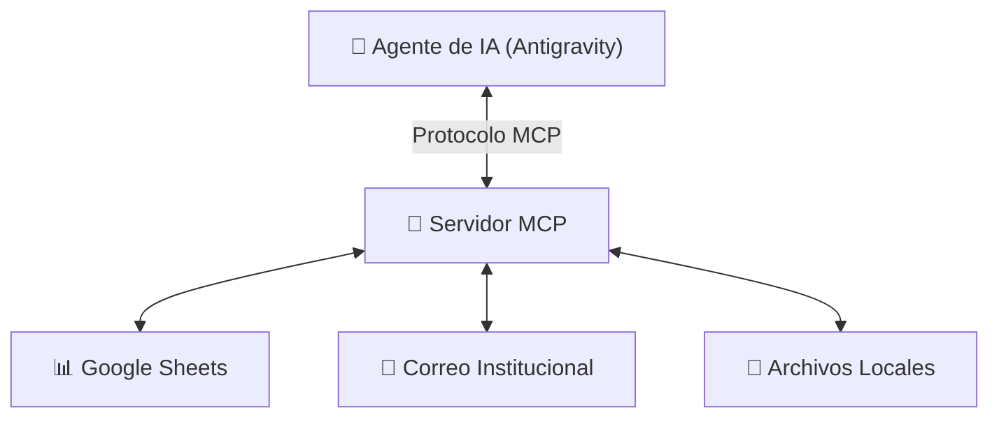

# Módulo 08: Introducción a Servidores MCP y Scripts Asistidos por IA

## 🎯 Objetivo del Módulo
Comprender el concepto de **Model Context Protocol (MCP)**, entender cómo los agentes de IA se conectan con herramientas del mundo real y aprender a guiar a la IA para crear pequeñas automatizaciones (*scripts asistidos*) sin escribir código manualmente.

---

## ⚙️ ¿Qué es MCP (Model Context Protocol)?

Hasta hace poco, un chatbot de IA solo podía procesar el texto que tú le pegabas en el chat. 

**Model Context Protocol (MCP)** es un estándar creado para que cualquier agente de IA pueda conectarse de forma segura a sistemas externos:
- Bases de datos de la empresa (SQL, Airtable).
- Hojas de cálculo en la nube (Google Sheets, Excel Online).
- Servicios de correo y mensajería (Gmail, Slack).
- Herramientas de almacenamiento local.



---

## 🐍 Automatizaciones y Scripts Asistidos por IA

Como profesional no técnico, no necesitas aprender la sintaxis de Python o JavaScript. Tu rol es actuar como el **Arquitecto y Auditor**:

### Cómo Pedir un Script de Automatización a la IA:
1. **Define el Problema**: *"Tengo una carpeta con 50 facturas en PDF y necesito extraer el total de cada una a un archivo Excel."*
2. **Solicita la Solución**: *"Crea un script sencillo en Python que lea los archivos PDF y genere el archivo `totales.csv`."*
3. **Pide Instrucciones de Ejecución**: *"Dime exactamente qué botón debo presionar en la interfaz para ejecutarlo."*

---

## 🎓 Cierre del Curso: Tu Nuevo Rol como Harness Engineer Practitioner

Al completar este programa, has pasado de ser un simple **usuario pasivo de chatbots** a un **Practicante de Harness Engineering**, capaz de:
- Estructurar el contexto de cualquier proyecto (`AGENT.md`, reglas y formatos).
- Diseñar comunicaciones y diagramas profesionales (Markdown, Slidev, Mermaid).
- Proteger el historial de trabajo (GitHub Desktop).
- Ampliar el alcance de la IA conectando herramientas avanzadas (MCP).

---

---

## 📝 Tarea Práctica del Módulo 08 (Homework)

### Objetivo:
Diseñar un escenario real de conexión MCP aplicado a tu contexto profesional.

### Instrucciones:

**Paso 1 — Elige una herramienta externa relevante** para tu área de trabajo:
- Opción A: **Google Sheets** — conectar el agente a una hoja de cálculo de reportes.
- Opción B: **Gmail o correo institucional** — leer asuntos de correos no respondidos y generar un resumen.
- Opción C: **Base de datos local** — una carpeta de archivos Excel o CSV con registros históricos.

**Paso 2 — Describe el escenario** respondiendo estas preguntas en un archivo `docs/tarea_08_mcp.md`:
1. ¿Qué información debe *leer* el agente desde esa herramienta?
2. ¿Qué información debe *escribir o actualizar* el agente?
3. ¿Qué acción NO debe realizar nunca el agente sin confirmación humana?

**Paso 3 — Redacta el prompt de tres pasos (Arquitecto y Auditor):**

Usando el esquema del módulo, escribe el prompt completo:

```
PASO 1 — DEFINICIÓN:
"Tengo [describe la herramienta y los datos]. Necesito que el agente [describe la tarea]."

PASO 2 — SOLICITUD DE SCRIPT:
"Crea un script que [acción concreta] y guarda el resultado en [nombre del archivo de salida]."

PASO 3 — INSTRUCCIONES DE EJECUCIÓN:
"Dime exactamente qué debo hacer para ejecutar este script sin usar la terminal manualmente."
```

### Criterio de Éxito:
- [ ] Archivo `docs/tarea_08_mcp.md` creado con las 3 preguntas respondidas.
- [ ] Prompt de 3 pasos redactado con datos reales de tu contexto de trabajo.
- [ ] Identificas al menos una acción que debe requerir confirmación humana antes de ejecutarse.

> 💡 **Consejo:** Este ejercicio es el más cercano al trabajo real de un Harness Engineer Practitioner — diseñas el arnés sin escribir una sola línea de código.

---

## 🔗 Referencias Externas y Recursos
- [Model Context Protocol (MCP) Documentation](https://modelcontextprotocol.io/)
- [Ecosistema de Servidores MCP Oficiales](https://github.com/modelcontextprotocol/servers)
