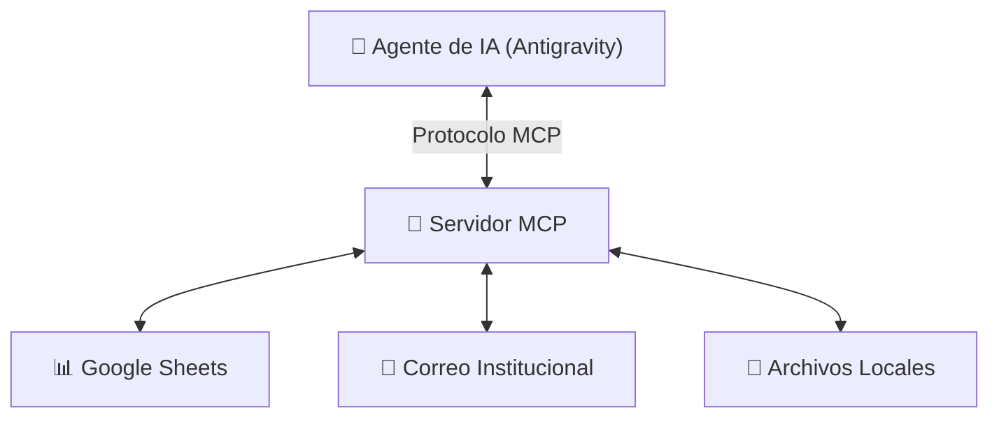

# Módulo 08: Introducción a Servidores MCP y Scripts Asistidos por IA

## 🎯 Objetivo del Módulo
Comprender el concepto de **Model Context Protocol (MCP)**, entender cómo los agentes de IA se conectan con herramientas del mundo real y aprender a guiar a la IA para crear pequeñas automatizaciones (*scripts asistidos*) sin escribir código manualmente.

---

## ⚙️ ¿Qué es MCP (Model Context Protocol)?

Hasta hace poco, un chatbot de IA solo podía procesar el texto que tú le pegabas en el chat. 

**Model Context Protocol (MCP)** es un estándar creado para que cualquier agente de IA pueda conectarse de forma segura a sistemas externos:
- Bases de datos de la empresa (SQL, Airtable).
- Hojas de cálculo en la nube (Google Sheets, Excel Online).
- Servicios de correo y mensajería (Gmail, Slack).
- Herramientas de almacenamiento local.

---

## 🐍 Automatizaciones y Scripts Asistidos por IA

Como profesional no técnico, no necesitas aprender la sintaxis de Python o JavaScript. Tu rol es actuar como el **Arquitecto y Auditor**:

### Cómo Pedir un Script de Automatización a la IA:
1. **Define el Problema**: *"Tengo una carpeta con 50 facturas en PDF y necesito extraer el total de cada una a un archivo Excel."*
2. **Solicita la Solución**: *"Crea un script sencillo en Python que lea los archivos PDF y genere el archivo `totales.csv`."*
3. **Pide Instrucciones de Ejecución**: *"Dime exactamente qué botón debo presionar en la interfaz para ejecutarlo."*

---

## 🎓 Cierre del Curso: Tu Nuevo Rol como Harness Engineer Practitioner

Al completar este programa, has pasado de ser un simple **usuario pasivo de chatbots** a un **Practicante de Harness Engineering**, capaz de:
- Estructurar el contexto de cualquier proyecto (`AGENT.md`, reglas y formatos).
- Diseñar comunicaciones y diagramas profesionales (Markdown, Slidev, Mermaid).
- Proteger el historial de trabajo (GitHub Desktop).
- Ampliar el alcance de la IA conectando herramientas avanzadas (MCP).

---

## 🔗 Referencias Externas y Recursos
- [Model Context Protocol (MCP) Documentation](https://modelcontextprotocol.io/)
- [Ecosistema de Servidores MCP Oficiales](https://github.com/modelcontextprotocol/servers)
