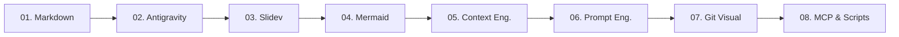

# Harness Engineering
### De Usuario de AI Chatbots a Diseñador de Entornos de Agentes

**Para Administradores, Docentes, Contadores y Líderes de Negocio**

  
    Presiona espacio o ➡️ para continuar <carbon:arrow-right class="inline"/>
  

---

# ¿Por qué Harness Engineering?

> "Un modelo de IA sin arnés es como un motor de Fórmula 1 sin chasis: mucha potencia, pero sin dirección ni control."

<v-clicks>

- 🧠 **Supera las limitaciones de los chatbots**: Pasa de hacer preguntas sueltas a crear flujos sostenibles.
- 📁 **Contexto vs Memoria**: Proporciona a la IA la información exacta en el formato adecuado.
- 🛠️ **Sin necesidad de programar**: Diseñado para perfiles ejecutivos y administrativos con alta capacidad de análisis.
- 🎯 **Resultado**: Automatizaciones confiables, reportes impecables y herramientas personalizadas.

</v-clicks>

---
layout: two-column
---

# Módulo 1: Markdown Fundamentos
### El Lenguaje Estándar de la IA

- 📊 **¿Por qué es obligatorio?**: 
  - +90% de los modelos LLM están entrenados en Markdown.
  - Genera archivos 95% más ligeros que Word/PDF.
- 📝 **Cheat Sheet Esencial**:
  - Encabezados (`#`, `##`)
  - Formato (*cursiva*, **negrita**)
  - Listas y Tablas
  - Enlaces y Bloques de Código

::right::

### 📘 Material de Estudio Detallado
Consulta la guía completa del módulo:
- Estadísticas de adopción global
- Ejemplos prácticos paso a paso
- Referencia completa del lenguaje

👉 **[Ver Guía 01: Markdown Fundamentos](file:///home/gallem/Desktop/curso-_harness_engineering/docs/01_markdown_guide.md)**

---
layout: two-column
---

# Módulo 2: Antigravity Ecosystem
### Tu Entorno de Trabajo con Agentes

- 🤖 **¿Qué es Antigravity?**:
  - Entorno avanzado de ejecución asistida por IA.
  - Orquestación de subagentes y herramientas integradas.
- 🌐 **Panorama de Agentes**:
  - Comparativa con otros asistentes del mercado.
  - Selección estratégica según requerimientos de negocio.

::right::

### 📘 Material de Estudio Detallado
Consulta la guía completa del módulo:
- Visión general del agente Antigravity
- Roles de subagentes e integración
- Arquitectura de ejecución

👉 **[Ver Guía 02: Ecosistema Antigravity](file:///home/gallem/Desktop/curso-_harness_engineering/docs/02_antigravity_guide.md)**

---
layout: two-column
---

# Módulo 3: Slidev Presentations
### Presentaciones Dinámicas en Markdown

- 🛝 **¿Por qué Slidev?**:
  - Convierte documentos Markdown directamente en diapositivas web.
  - Elimina horas perdidas editando formato en PowerPoint.
- 📤 **Exportación Flexible**:
  - Exporta a **PDF** listo para imprimir/enviar.
  - Exporta a **HTML** presentable en cualquier navegador.

::right::

### 📘 Material de Estudio Detallado
Consulta la guía completa del módulo:
- Estructura de diapositivas en Markdown (`---`)
- Integración de código y diagramas
- Guía de exportación paso a paso

👉 **[Ver Guía 03: Presentaciones con Slidev](file:///home/gallem/Desktop/curso-_harness_engineering/docs/03_slidev_guide.md)**

---
layout: two-column
---

# Módulo 4: Mermaid Diagrams
### Diagramación Basada en Texto

- 📊 **¿Por qué Mermaid?**:
  - Permite crear flujogramas, organigramas y mapas visuales escribiendo texto simple.
  - La IA entiende y genera diagramas Mermaid a la perfección.
- ⚡ **Eficiencia Extrema de Tokens**:
  - Un diagrama completo requiere **solo ~20-50 tokens** de texto plano.
  - Ahorra +90% de ventana de contexto comparado con procesar imágenes o PDFs pesados.
- 🎨 **Formatos de Salida**:
  - Renderizado directo en GitHub/Markdown/Slidev.
  - Exportable a imágenes (PNG/SVG/PDF).

::right::

### 📘 Material de Estudio Detallado
Consulta la guía completa del módulo:
- Eficiencia de tokens y lectura analítica de IA
- Sintaxis elemental de `flowchart`
- Diagramas de secuencia y procesos
- Casos prácticos administrativos

👉 **[Ver Guía 04: Diagramas con Mermaid](file:///home/gallem/Desktop/curso-_harness_engineering/docs/04_mermaid_guide.md)**

---
layout: two-column
---

# Módulo 5: Context Engineering
### El Pilar Fundamental del Arnés

- 🧠 **Contexto vs Memoria**: La IA no "recuerda", lee contexto en cada interacción.
- 📄 **Archivos de Contexto**:
  - `AGENT.md` y `CLAUDE.md`: Las reglas de juego del proyecto.
- 🧰 **Tools & Skills**:
  - **Tools**: Capacidades de lectura, escritura y ejecución.
  - **Skills**: Paquetes de instrucciones especializadas reusables.

::right::

### 📘 Material de Estudio Detallado
Consulta la guía completa del módulo:
- Estructura de un archivo `AGENT.md`
- Creación de Skills y reglas
- Estrategias de aislamiento de contexto

👉 **[Ver Guía 05: Ingeniería de Contexto](file:///home/gallem/Desktop/curso-_harness_engineering/docs/05_context_engineering.md)**

---
layout: two-column
---

# Módulo 6: Prompt Engineering Práctico
### Instrucciones de Alto Impacto

- 🚫 **Evita "Prompts Dummy"**:
  - *Mal prompt*: "Hazme un reporte de ventas."
  - *Prompt efectivo*: Asignación de rol + Contexto + Restricciones + Formato de salida.
- 📐 **Fórmula de Estructura**:
  1. Rol / Persona
  2. Tarea u Objetivo
  3. Restricciones y Reglas
  4. Formato de Salida Esperado

::right::

### 📘 Material de Estudio Detallado
Consulta la guía completa del módulo:
- Plantillas de prompts administrativos
- Técnicas de Few-Shot y Chain-of-Thought
- Checklist de verificación pre-prompt

👉 **[Ver Guía 06: Prompt Engineering Práctico](file:///home/gallem/Desktop/curso-_harness_engineering/docs/06_prompt_engineering.md)**

---
layout: two-column
---

# Módulo 7: Control de Versiones
### Git y GitHub Desktop sin Terminal

- 📦 **¿Por qué Control de Versiones?**:
  - Mantiene el historial completo de cambios en tus documentos y proyectos de arnés.
  - Permite volver en el tiempo si una modificación falla.
- 🖥️ **GitHub Desktop**:
  - Interfaz 100% gráfica e intuitiva.
  - Sin comandos de consola ni complejidad técnica.

::right::

### 📘 Material de Estudio Detallado
Consulta la guía completa del módulo:
- Conceptos de Repositorio, Commit y Sync
- Configuración inicial de GitHub Desktop
- Flujo de trabajo diario no técnico

👉 **[Ver Guía 07: Git y GitHub Desktop](file:///home/gallem/Desktop/curso-_harness_engineering/docs/07_version_control.md)**

---
layout: two-column
---

# Módulo 8: MCP y Scripts Asistidos
### El Salto a la Automatización Avanzada

- ⚙️ **¿Qué es MCP (Model Context Protocol)?**:
  - Estándar abierto que permite a la IA conectarse con bases de datos, APIs y servicios externos.
- 🐍 **Scripts Sencillos Asistidos por IA**:
  - Aprende a guiar a la IA para crear pequeñas automatizaciones de tareas repetitivas.

::right::

### 📘 Material de Estudio Detallado
Consulta la guía completa del módulo:
- Concepto e importancia de MCP
- Conexión de servidores MCP en agentes
- Ejemplos de scripts administrativos

👉 **[Ver Guía 08: MCP y Scripts Asistidos](file:///home/gallem/Desktop/curso-_harness_engineering/docs/08_mcp_and_scripts.md)**

---

# Resumen del Programa

### 🏆 Tu Siguiente Paso:
1. Explora el mapa general en [`README.md`](file:///home/gallem/Desktop/curso-_harness_engineering/README.md).
2. Lee detenidamente las guías conceptuales en la carpeta `docs/`.
3. Comienza a aplicar *Harness Engineering* en tus proyectos profesionales diarios.
